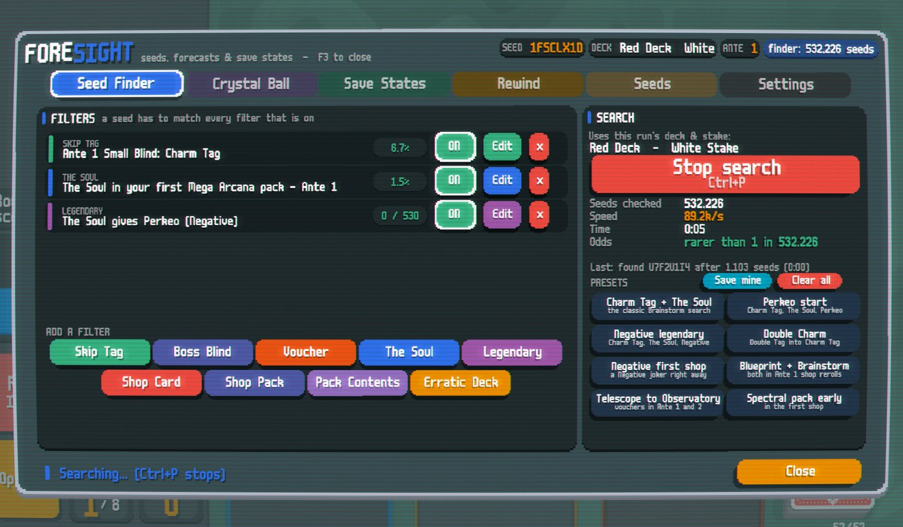
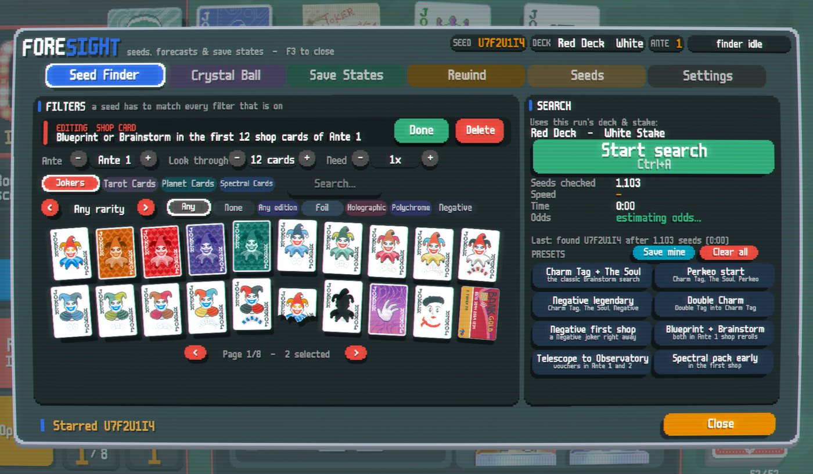
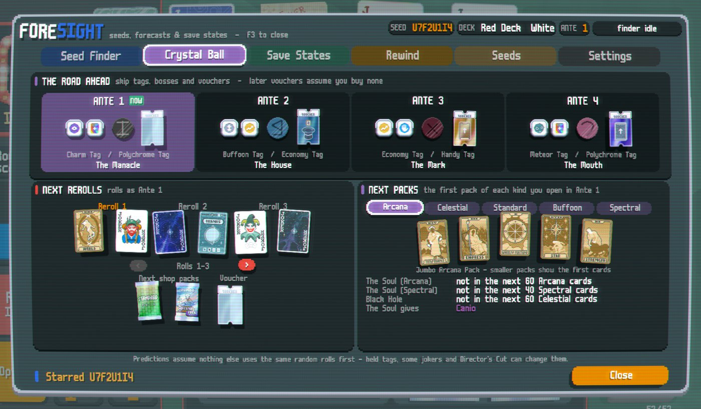
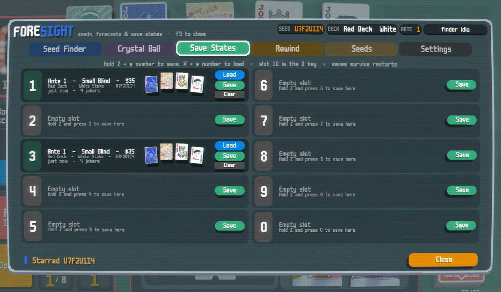
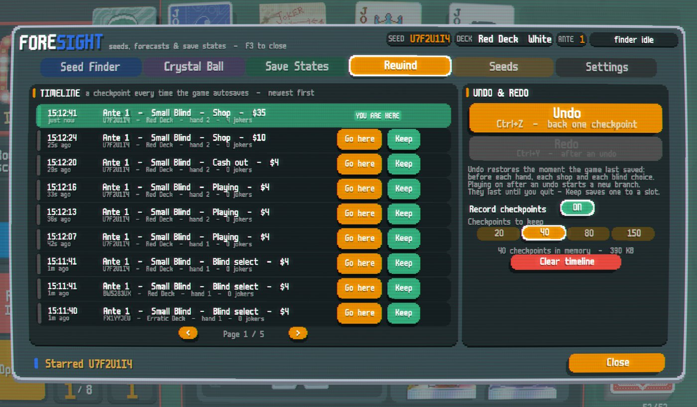

# Foresight

**Seed finder, run forecast, save states and rewind for Balatro.** A replacement for Brainstorm: the same hotkeys, plus stackable seed filters, a crystal ball that shows what your run has in store, ten save-state slots, and undo for every hand, all in one menu (**F3**).

Predictions run the game's own generation code against a sandboxed copy of the random state, so modded tags, jokers, packs, bosses and rarities count. Predicting never changes your run.

## Features

### Seed Finder
Stack as many filters as you like; a seed has to match every filter that is switched on. Each filter has a visual editor with real card, tag and blind art.

| Filter | Checks |
| --- | --- |
| Skip Tag | The tag for skipping the Small or Big Blind (or either, or both) at any ante |
| Boss Blind | Which boss shows up at an ante, or that certain bosses never appear through an ante |
| Voucher | The voucher in an ante's shop, optionally assuming you bought the earlier ones |
| The Soul | The Soul or Black Hole in your first pack(s) of a kind, e.g. the Charm Tag's Mega Arcana |
| Legendary | Which legendary joker The Soul creates, and its edition |
| Shop Card | Specific jokers or cards, or any joker of a rarity or edition, within the first N shop cards (rerolls included) |
| Shop Pack | Pack kinds and sizes within the first N shop packs |
| Pack Contents | Cards inside the first pack of a kind you open in an ante |
| Erratic Deck | At least N cards of a suit, a rank, or face cards in the randomised starting deck |

The finder checks tens of thousands of seeds per second while the game stays smooth, shows live per-filter pass rates and the estimated odds, and starts the first match. It comes with presets (Charm Tag + The Soul, Perkeo start, Negative legendary, Double Charm, Blueprint + Brainstorm, ...) and you can save your own.

### Crystal Ball
What the current run has in store: skip tags, bosses and vouchers for the next four antes; the next shop and its rerolls (or the next rerolls while you are in a shop) with editions; the next shop's packs; the contents of the first pack of each kind; where the next Soul and Black Hole are; and which legendary The Soul would give right now.

### Save States
Ten slots, each with a preview of the ante, blind, money, deck, seed and jokers. They use the same files as Brainstorm (`saveState1.jkr`, ...), so Brainstorm's slots show up here, and they survive restarts.

### Rewind
Every autosave - before each hand, each shop and each blind choice - becomes a checkpoint. Undo a misplay with **Ctrl+Z**, redo with **Ctrl+Y**, jump to any checkpoint, or keep one by copying it into a save slot.

### Seeds
The current seed (copy, restart, star it), play any seed on any deck and stake, and a history of recent runs (best ante, wins, how the seed was found) plus favourites.

| | |
| --- | --- |
|  |  |

## Hotkeys

| Keys | Action |
| --- | --- |
| **F3** | Open / close Foresight |
| Hold **Z** + **1-9 / 0** | Save state to slot 1-10 (or hold the number, then press Z) |
| Hold **X** + **1-9 / 0** | Load state from slot 1-10 |
| **Ctrl+T** | New run on a random seed (same deck, stake and challenge) |
| **Ctrl+Shift+T** | Restart the current seed |
| **Ctrl+A** | Start / stop the seed finder |
| **Ctrl+P** | Stop the seed finder |
| **Ctrl+Z** / **Ctrl+Y** | Undo / redo |

The menu key and the save / load keys can be rebound, and each group of shortcuts switched off, in *Settings*. There is also a Foresight button in the pause menu.

## Installation

1. Install [Lovely](https://github.com/ethangreen-dev/lovely-injector) and [Steamodded](https://github.com/Steamodded/smods) (version 26.829.0 or newer).
2. Download `Foresight-<version>.zip` from the Releases page and extract it into your Mods folder, so that you end up with `Mods/Foresight/Foresight.json`.
   - Windows: `%AppData%\Balatro\Mods`
   - macOS: `~/Library/Application Support/Balatro/Mods`
3. Start the game and press **F3**.

### Coming from Brainstorm
Disable or remove Brainstorm first - both mods use the same hotkeys. Your Brainstorm save states load as-is, and Foresight also adds the faster game speeds (up to 64x) that Brainstorm patched into *Settings > Game*.

## Notes

- The finder predicts from a fresh run of your current deck and stake. If the run has already moved on, it starts a fresh one first and reopens the menu.
- Like Brainstorm, found seeds count as normal unseeded runs (unlocks and stats). Switch that off in *Settings* to play them as seeded runs.
- After a seed is found, its ante 1 tags, boss and voucher are checked against the real run, and any difference is reported.
- Predictions assume nothing else uses the same random rolls first. Held tags (e.g. Rare Tag), some jokers, and boss rerolls can change shop and boss forecasts.
- Tested on Steamodded 26.829.0 with Lovely 0.10.0, both with vanilla content only and with a 60+ mod pack (including Paperback and Amulet).

## Changelog

See [CHANGELOG.md](CHANGELOG.md).

## License

[MIT](LICENSE) - Copyright (c) 2026 Wickedlizerd
